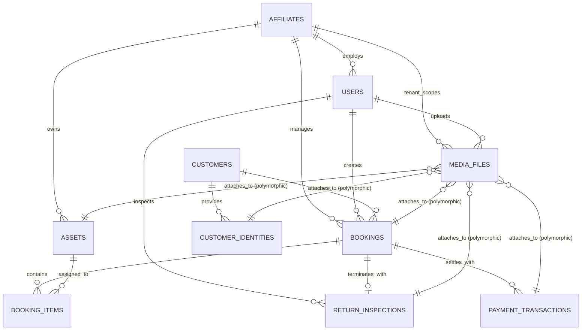
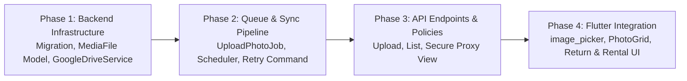

# RentCore — Google Drive Photo Storage Architecture & Implementation Plan

**Document Version:** 1.0.0  
**Date:** October 11, 2026  
**Status:** Architecture Audit & Technical Specification (Pre-Implementation Baseline)  
**Target Systems:** Laravel 12 Backend API + MySQL 8.0 + Flutter Riverpod Mobile Client  
**Reference Document:** `RENTAL_APP_PRD.md` (v1.5.0)  

---

## 1. Executive Summary & Objective

This document details the architectural audit, structural design, and end-to-end implementation plan for integrating **Google Drive Photo Storage** into the **RentCore** electronic rental management system.

### Operational Context
RentCore powers high-frequency walk-in counter rentals and field inspections for serialized smartphones (primarily iPhones) and consumer electronics across multi-tenant franchise branches. The system requires structured photo management across four critical operational domains:
1. **Inventory & Asset Catalog**: Initial physical device condition, cosmetic wear, IMEI stickers, serial tags, and catalog reference imagery.
2. **Transaction Evidence & Customer Collateral**: Photographs of government identity cards (KTP/SIM/Kartu Pelajar) held as collateral in physical safe slots (`collateral_storage_slot`), handover signatures, and contract proofs.
3. **Return Inspection & Condition Documentation**: Intake documentation during device returns, including physical screen condition, casing scuffs, accessory completeness, iCloud sign-out proof, and condition grade justification (Grade A, B, or C).
4. **Financial Payment Proof**: Bank transfer receipts, EDC slips, and QRIS settlement confirmation screenshots.

### Scale & Throughput Requirements
- **Expected Daily Volume**: 50 to 200 photos per day across branch operations.
- **Estimated Storage Footprint**: At an average compressed JPEG size of 1.5–2.5 MB per photo, daily ingestion is approximately **100–500 MB/day** (~3–15 GB/month, ~36–180 GB/year).
- **Access Mandate**: Authorized franchise operators, technicians, cashiers, and company executives must be able to view, preview, and access photo evidence through authenticated application views and authoritative Google Drive web links.

---

## 2. Existing System Inspection & Codebase Audit

A forensic audit of the current Laravel 12 backend and Flutter mobile client was performed without modifying application code or production database data.

### 2.1 Backend Codebase Audit (`rentcore_backend` / `laragon/www/rentcore`)

| Component | Current State | Findings & Constraints |
| :--- | :--- | :--- |
| **Framework & Runtime** | Laravel 12.x on PHP 8.3 (Windows Laragon / CLI) | Active MySQL connection `rentcore_db`. Modern framework capabilities available. |
| **API Endpoints** | `routes/api.php` | Existing photo endpoint: `POST /api/v1/customers/{id}/identity-document` (`CustomerController::uploadIdentityDocument`). No photo endpoints for assets, returns, or payments. |
| **Identity Upload Logic** | `CustomerController.php` lines 145–195 | Accepts multipart file or base64 string. Stores files to local storage: `Storage::disk('public')->storeAs('customer_identities', $filename)`. Updates `customer_identities.file_path`. |
| **Counter Rental Service** | `BookingService.php` lines 61–78 | Reads `identity_photo_base64` or `identity_photo`, saves locally to `public/customer_identities/`, but only links it to `CustomerIdentity` if `identity_number` was supplied in the request payload. |
| **Return Inspection Service** | `ReturnService.php` lines 21–152 | Captures checklist JSON, condition grade (A/B/C), battery health, and calculates late penalties. **Contains zero photo persistence logic or photo upload fields.** |
| **Filesystems Configuration** | `config/filesystems.php` | Default disk is `'local'`. `'public'` disk points to `storage/app/public`. **No Google Drive adapter or cloud storage disk is registered.** |
| **Queue Configuration** | `config/queue.php` & `.env` | `QUEUE_CONNECTION=database`. Table `jobs` exists in migration `0001_01_01_000002_create_jobs_table.php`. |
| **Multi-Tenant Scoping** | `FranchiseTenantScope.php` | Eloquent models `Asset` and `Booking` enforce `affiliate_id` scoping automatically for non-super-admin users. |
| **Audit Logging** | `AuditLogService.php` | Centralized immutable audit logger writing to `audit_logs` table. |

### 2.2 Mobile Client Audit (`rentcore_mobile`)

| Component | Current State | Findings & Constraints |
| :--- | :--- | :--- |
| **Flutter Version & SDK** | Flutter 3.29+ / Dart ^3.13.5 | Modern Null-Safe Dart with Riverpod 3.x. |
| **Dependencies (`pubspec.yaml`)** | `dio: ^5.11.1`, `flutter_riverpod: ^3.4.3`, `shared_preferences: ^2.5.6` | **Camera and file picking dependencies (`image_picker`, `camera`) are not yet installed.** |
| **Direct Rental Form** | `direct_rental_screen.dart` | Has an "Encrypted ID Document Photo Vault" UI card (lines 975–1050), but `_attachIdentityDocument()` generates a mock base64 placeholder string (`RENTCORE_SECURE_VAULT_AES256_...`) rather than opening a hardware camera or gallery picker. |
| **Return Wizard Form** | `return_wizard_screen.dart` | Collects iCloud check, screen check, accessories, and grade choice chips. **Contains no photo capture widget or camera integration.** |
| **Network Client** | `api_client.dart` | Standard Dio instance configured for JSON payloads. Requires support for multipart/form-data upload progress indicators. |

---

## 3. Entity & Multi-Tenant Relationship Mapping

All photo attachments must strictly respect RentCore's franchise multi-tenant data boundary. Staf Cabang Mataram must never see customer identity photos or inspection photos belonging to Cabang Senggigi.



### Domain Mapping Breakdown:
1. **Customer Identity Evidence**:
   - Primary Entity: `CustomerIdentity` (`customer_id`, `identity_type`, `identity_number`).
   - Tenant Scope: Inherited through customer's active branch booking.
   - Sensitivity: **CRITICAL / PII**. Requires strict access restrictions.
2. **Device Return Condition Evidence**:
   - Primary Entity: `ReturnInspection` (`booking_id`, `inspected_by`, `condition_grade`).
   - Tenant Scope: Inherited via `booking.affiliate_id`.
   - Sensitivity: Operational / Dispute Evidence.
3. **Asset Inventory Condition**:
   - Primary Entity: `Asset` (`affiliate_id`, `model_id`, `serial_number`, `imei_1`).
   - Tenant Scope: Direct `affiliate_id`.
   - Sensitivity: Branch operational asset.
4. **Payment Proof**:
   - Primary Entity: `PaymentTransaction` (`booking_id`, `processed_by`, `type`, `amount`).
   - Tenant Scope: Inherited via `booking.affiliate_id`.
   - Sensitivity: Financial compliance record.

---

## 4. Hosting Environment & Queue Worker Reliability

### Current Environment Assessment
- **Local / Staging Environment**: Windows 11 with Laragon (Nginx/Apache, MySQL 8.0, PHP 8.3 CLI).
- **Queue Connection**: `.env` specifies `QUEUE_CONNECTION=database`, but in a Windows developer or staging setup, background daemon workers (such as Linux `systemd` or `supervisor`) are **not active by default** unless manually spawned via terminal (`php artisan queue:work`).
- **Target Production Environment**: Typical Indonesian SME/franchise infrastructure runs either:
  1. Linux Ubuntu VPS with Nginx + PHP-FPM + Supervisor daemon.
  2. Managed cPanel/DirectAdmin shared hosting (where persistent queue workers are unreliable or unsupported).

### The Inherent Risk of Google Drive Direct Uploads
Direct synchronous uploads to Google Drive over mobile counter networks (4G/5G) present severe operational risks:
- Google Drive API upload latency for a 3 MB photo ranges from **1.5 to 6 seconds** depending on connection speed.
- If a cashier takes 3 return photos and uploads them synchronously, the counter app would freeze for 5–18 seconds, disrupting customer handover.
- If Google Drive API experiences rate limits, SSL timeouts, or transient network drops, a synchronous transaction fails or drops the photo entirely.

### Architectural Decision: Dual-Tier Asynchronous Buffered Pipeline
To ensure 100% counter responsiveness regardless of queue worker availability:
1. **Immediate Local Buffer (Tier 1)**:
   - When the mobile app uploads a photo, Laravel immediately validates and writes it to a temporary local disk buffer (`storage/app/private/photos_temp/{affiliate_id}/...`).
   - A `media_files` database record is immediately created with `sync_status = 'pending'`, and an instant response (HTTP 201) is returned to Flutter within < 250ms with a local preview URL.
   - The cashier or inspector proceeds immediately with their operational workflow without blocking.
2. **Background Google Drive Streaming (Tier 2)**:
   - An asynchronous job `UploadPhotoToGoogleDriveJob` is dispatched to the Laravel queue.
   - **Queue Active Scenario**: The queue worker picks up the job, streams the local file to the targeted Google Drive folder, receives the `gdrive_file_id` and `gdrive_web_view_link`, updates `sync_status = 'synced'`, and deletes the local temporary file (or retains it in cache).
   - **Queue Inactive / Worker Failure Scenario (Fail-Safe)**: A scheduled Artisan command `php artisan storage:sync-drive` runs periodically (e.g., every 5 minutes via scheduler or Windows Task Scheduler) to query all records with `sync_status = 'pending'` or `sync_status = 'failed'` and process them in batches.

---

## 5. Google Drive Authentication & Storage Ownership Constraints

### 5.1 Evaluation of Authentication Strategies

| Method | Mechanism | Advantages | Disadvantages / Blockers | Verdict |
| :--- | :--- | :--- | :--- | :---: |
| **Strategy A: Google Cloud Service Account** | Headless machine account (`xxx@project.iam.gserviceaccount.com`) using JSON Private Key. | Completely headless, zero human token refreshes, no interactive browser login required. | **Severe Storage Trap**: Personal Service Accounts have **0 GB storage quota**. Files uploaded to a personal folder fail unless: (a) Uploaded to a paid Google Workspace Shared Drive, OR (b) Shared personal folder with Editor rights, but file ownership remains tricky. | **Recommended ONLY if Google Workspace Shared Drive is used.** |
| **Strategy B: OAuth 2.0 with Long-Lived Refresh Token** | Master Company Account (e.g. `skyrental.drive@gmail.com` or corporate account) authorized once via OAuth consent screen to generate a persistent `refresh_token`. | Uses the full storage quota of the company account (15 GB free or 100 GB–2 TB Google One). Files are directly owned by the company account. Works on standard `@gmail.com` accounts. | Requires an initial 1-time authorization ceremony. If GCP OAuth app is in "Testing" mode, refresh tokens expire after 7 days; requires app status set to "Production" (External or Internal). | **RECOMMENDED BASELINE (Most Flexible for SME / Franchise).** |
| **Strategy C: Domain-Wide Delegation** | Service account impersonating a Workspace user (`admin@skyrental.id`). | Native ownership, no manual tokens. | Strictly requires paid Google Workspace enterprise domain. Incompatible with standard Gmail accounts. | **Viable only if client confirms Google Workspace.** |

### 5.2 Storage Hierarchy on Google Drive
To ensure clean auditability by branch managers and business owners directly inside the Google Drive web interface, files are organized into a strict hierarchical folder tree:

```
[RentCore_Root_Folder]/                       <-- Configured via GDRIVE_ROOT_FOLDER_ID
├── Cabang_MTR_Mataram/                       <-- Auto-created per Affiliate Code
│   ├── inventory/                            <-- Asset & device condition photos
│   ├── customers/                            <-- KTP / SIM collateral documents
│   ├── returns/                              <-- Return condition inspections & damage
│   └── payments/                             <-- Transfer slips & settlement proofs
├── Cabang_SGG_Senggigi/
│   ├── inventory/
│   ├── customers/
│   ├── returns/
│   └── payments/
└── Kantor_Pusat/
    └── ...
```
The system caches Google Drive folder IDs in the local database or Redis cache to avoid redundant `files.list` API queries on every upload.

### 5.3 Link Permissions & Access Security Model
The user requirement states: *"authorized users need to access photos through Google Drive links."*

**Security Threat Analysis:**
If Google Drive file permissions are set to `"Anyone with the link can view"` (`type: anyone, role: reader`):
- Anyone who obtains the URL (via shared link, browser history, or leaked payload) can access customer government identity cards (KTP/SIM) without authentication.
- This directly violates PRD Section 10.1 (*"Customer Privacy Protection: Identity document photos stored in secure storage, accessible only via signed temporary URLs"*).

**Proposed Controlled Access Model:**
1. **Tier A — Public / General Operational Photos** (Device inventory, casing grade, accessories returned):
   - Drive file permission: `type: anyone, role: reader`.
   - Web view link: Direct Google Drive URL (`https://drive.google.com/file/d/{fileId}/view`).
   - Accessible directly in Flutter web view or external browser.
2. **Tier B — Sensitive PII & Financial Evidence** (Customer KTP/SIM, payment slips):
   - Drive file permission: Restricted to the corporate Google Drive domain / company email only.
   - Flutter access: Served via authenticated API proxy endpoint:
     `GET /api/v1/photos/{id}/view`
   - The endpoint validates the user's Sanctum Bearer token, enforces `affiliate_id` tenancy, verifies user role, records an audit log entry in `audit_logs`, and either:
     - Streams the image content securely to the client, OR
     - Redirects authorized staff with an ephemeral signed Google Drive link.

---

## 6. Proposed Architecture, Database Changes & API Contract

### 6.1 Database Schema (Zero Duplicate Tables)

Instead of creating fragmented tables (`inventory_photos`, `return_photos`, `customer_photos`), RentCore will implement a unified polymorphic table: `media_files`.

```sql
CREATE TABLE media_files (
    id BIGINT UNSIGNED AUTO_INCREMENT PRIMARY KEY,
    affiliate_id BIGINT UNSIGNED NOT NULL,
    uploader_id CHAR(36) NOT NULL,
    
    -- Polymorphic Relation (Asset, CustomerIdentity, ReturnInspection, PaymentTransaction, Booking)
    attachable_type VARCHAR(100) NOT NULL,
    attachable_id BIGINT UNSIGNED NOT NULL,
    
    -- Category classification
    collection ENUM(
        'customer_identity', 
        'return_condition', 
        'damage_proof', 
        'asset_catalog', 
        'asset_condition', 
        'payment_receipt'
    ) NOT NULL DEFAULT 'return_condition',
    
    -- File Metadata
    original_name VARCHAR(255) NOT NULL,
    file_name VARCHAR(255) NOT NULL,
    mime_type VARCHAR(100) NOT NULL DEFAULT 'image/jpeg',
    file_size_bytes BIGINT UNSIGNED NOT NULL DEFAULT 0,
    caption VARCHAR(255) NULL,
    
    -- Storage Engine Attributes
    disk VARCHAR(50) NOT NULL DEFAULT 'local',
    local_path VARCHAR(255) NULL,
    
    -- Google Drive Identifiers
    gdrive_file_id VARCHAR(150) NULL,
    gdrive_folder_id VARCHAR(150) NULL,
    gdrive_web_view_link TEXT NULL,
    gdrive_thumbnail_link TEXT NULL,
    
    -- Background Sync Pipeline Status
    sync_status ENUM('pending', 'syncing', 'synced', 'failed') NOT NULL DEFAULT 'pending',
    sync_attempts INT UNSIGNED NOT NULL DEFAULT 0,
    sync_error TEXT NULL,
    synced_at DATETIME NULL,
    
    created_at TIMESTAMP NULL DEFAULT CURRENT_TIMESTAMP,
    updated_at TIMESTAMP NULL DEFAULT CURRENT_TIMESTAMP ON UPDATE CURRENT_TIMESTAMP,
    
    CONSTRAINT fk_media_affiliate FOREIGN KEY (affiliate_id) REFERENCES affiliates(id) ON DELETE RESTRICT,
    CONSTRAINT fk_media_uploader FOREIGN KEY (uploader_id) REFERENCES users(id) ON DELETE RESTRICT,
    
    INDEX idx_media_attachable (attachable_type, attachable_id),
    INDEX idx_media_affiliate_collection (affiliate_id, collection),
    INDEX idx_media_sync_status (sync_status, sync_attempts),
    INDEX idx_media_gdrive_id (gdrive_file_id)
) ENGINE=InnoDB DEFAULT CHARSET=utf8mb4 COLLATE=utf8mb4_unicode_ci;
```

**Backwards Compatibility Guarantee:**
- The existing `customer_identities.file_path` column remains completely intact.
- When an identity photo is uploaded, `file_path` is updated as before, while a corresponding `media_files` record is created to handle Google Drive streaming and cloud linkage.

---

### 6.2 Laravel Service Architecture & Package Selection

#### Package Choice
To ensure maximum compatibility with Laravel 12 and PHP 8.3:
- Use official Google API Client: `google/apiclient: ^2.16` (or `masbug/flysystem-google-drive-ext: ^2.0` for Flysystem disk driver).
- Direct use of Google Drive v3 Service (`Google\Service\Drive`) provides granular control over folder creation, permissions, parent folder assignment, and thumbnail generation.

#### Core Service Components
1. `App\Services\GoogleDriveService`:
   - Handles OAuth token refresh or Service Account authentication.
   - Manages automatic branch folder resolution (`getOrCreateFolder(path)`).
   - Uploads file stream with resumable/chunked uploads.
   - Sets file sharing permissions (`permissions.create`).
2. `App\Jobs\UploadPhotoToGoogleDriveJob`:
   - Implements `ShouldQueue`, `InteractsWithQueue`, `Queueable`, `SerializesModels`.
   - Backoff: `[5, 30, 120]` seconds (3 retry attempts).
   - On completion: Updates `media_files.sync_status = 'synced'` and saves `gdrive_web_view_link`.
   - On unrecoverable failure: Updates `sync_status = 'failed'` and logs exception to `sync_error`.
3. `App\Console\Commands\SyncGoogleDrivePhotosCommand`:
   - Artisan command: `php artisan storage:sync-drive --limit=50`.
   - Fail-safe runner for cron/scheduler when daemon queue worker is paused.

---

### 6.3 RESTful API Contract

#### 1. Upload Photo Attachment
- **Endpoint**: `POST /api/v1/photos/upload`
- **Headers**: `Authorization: Bearer <token>`, `Accept: application/json`
- **Content-Type**: `multipart/form-data`
- **Request Body**:
  | Field | Type | Required | Description |
  | :--- | :--- | :---: | :--- |
  | `photo` | File (image) | Yes | Image file (JPEG, PNG, WEBP, max 10MB). |
  | `attachable_type` | String | Yes | Target model: `return_inspection`, `customer_identity`, `asset`, `payment_transaction`, `booking`. |
  | `attachable_id` | Integer | Yes | ID of the target record. |
  | `collection` | String | Yes | Category: `return_condition`, `damage_proof`, `customer_identity`, `payment_receipt`, `asset_catalog`. |
  | `caption` | String | No | Short notes / description of the photograph. |
- **Response** (`201 Created`):
```json
{
  "success": true,
  "message": "Foto berhasil diunggah ke antrean penyimpanan cloud.",
  "data": {
    "id": 142,
    "attachable_type": "return_inspection",
    "attachable_id": 85,
    "collection": "return_condition",
    "file_name": "ret_85_1728649821_a8f9.jpg",
    "file_size_bytes": 1845210,
    "sync_status": "pending",
    "local_preview_url": "http://rentcore.test/storage/photos_temp/ret_85_1728649821_a8f9.jpg",
    "gdrive_web_view_link": null,
    "created_at": "2026-10-11T19:30:00+07:00"
  }
}
```

#### 2. Get Photos for an Entity
- **Endpoint**: `GET /api/v1/{entity_type}/{entity_id}/photos`
- **Example**: `GET /api/v1/bookings/12/photos`, `GET /api/v1/returns/85/photos`, `GET /api/v1/assets/5/photos`
- **Headers**: `Authorization: Bearer <token>`
- **Response** (`200 OK`):
```json
{
  "success": true,
  "data": [
    {
      "id": 142,
      "collection": "return_condition",
      "caption": "Kondisi layar & bodi belakang saat kembali",
      "sync_status": "synced",
      "preview_url": "https://drive.google.com/thumbnail?id=1AbCdEfGhIjKlMnOp&sz=w800",
      "gdrive_web_view_link": "https://drive.google.com/file/d/1AbCdEfGhIjKlMnOp/view?usp=drivesdk",
      "file_size_formatted": "1.76 MB",
      "uploader": {
        "id": "9d3e8a12-...",
        "name": "Budi Kasir"
      },
      "created_at": "2026-10-11T19:30:00+07:00"
    }
  ]
}
```

#### 3. View / Open Secure Photo
- **Endpoint**: `GET /api/v1/photos/{id}/view`
- **Headers**: `Authorization: Bearer <token>`
- **Behavior**: Verifies `affiliate_id` isolation. If user has access, redirects with HTTP 302 to `gdrive_web_view_link` or streams local cached copy.

#### 4. Retry Failed Photo Sync
- **Endpoint**: `POST /api/v1/photos/{id}/retry-sync`
- **Headers**: `Authorization: Bearer <token>`
- **Response** (`200 OK`): Re-dispatches upload job to queue.

---

### 6.4 Flutter Mobile Client Component Blueprint

To deliver an exceptional counter experience with zero lag:
1. **New Package**: Add `image_picker: ^1.1.2` to `rentcore_mobile/pubspec.yaml`.
2. **Reusable Widget: `PhotoAttachmentGrid`**:
   - Renders a horizontal or compact grid of photo cards.
   - "Tambah Foto" tile with modal sheet: **Ambil Foto (Kamera)** vs **Pilih dari Galeri**.
   - Thumbnail card displaying:
     - Real-time upload progress bar.
     - Cloud status icon:
       - Amber Cloud with Spinner: `sync_status = pending / syncing` (tersimpan lokal, mengunggah ke Drive).
       - Green Cloud with Checkmark: `sync_status = synced` (tersimpan permanen di Google Drive).
       - Red Cloud with Warning: `sync_status = failed` (tombol tap untuk coba ulang).
     - Tap thumbnail opens full-screen interactive preview with a **"Buka di Google Drive"** action button.
3. **Screen Integrations**:
   - **`ReturnWizardScreen`**: Insert `PhotoAttachmentGrid` directly below the physical condition checklist. Cashier takes 1–3 photos of the returned device before clicking "Proses Pengembalian".
   - **`DirectRentalScreen`**: Replace the mock `_attachIdentityDocument()` with live camera capture of customer KTP.
   - **`AssetDetailScreen` / `InventoryScreen`**: View device condition history and catalog images.

---

## 7. Security, Privacy & Multi-Tenant Guardrails

1. **Strict Multi-Tenant Scoping**:
   - Every `media_files` record requires an immutable `affiliate_id`.
   - The `PhotoPolicy` checks `$user->affiliate_id === $mediaFile->affiliate_id || $user->isSuperAdmin()`. Any cross-branch query returns **HTTP 403 Forbidden**.
2. **PII Protection for Identity Documents**:
   - Files with collection `'customer_identity'` are flagged as sensitive.
   - Drive file permissions are kept restricted. Access is mediated exclusively through authenticated backend endpoints.
3. **Audit Trail**:
   - Photo upload, deletion, and cross-branch access attempts log immutable entries to `audit_logs` storing staff UUID, IP address, and media ID.
4. **Local Storage Cleanup**:
   - Local temporary files in `storage/app/private/photos_temp` are purged after successful Google Drive confirmation, preventing disk exhaustion on the host server.

---

## 8. Unresolved Configuration Requirements & Stakeholder Decisions

Before executing the implementation phase, the following operational configurations and credentials must be provided or decided by the project owner:

| ID | Configuration Item | Description & Stakeholder Decision Required | Default Fallback if Unresolved |
| :---: | :--- | :--- | :--- |
| **CONF-01** | **Google Account Type** | Will RentCore use a **Standard Google Account** (`@gmail.com` with Google One storage) or a **Google Workspace Domain** (with Shared Drives)? | Default to **OAuth 2.0 Refresh Token** on standard Google Account. |
| **CONF-02** | **GCP Project & OAuth Credentials** | Requires a Google Cloud Console Project with **Google Drive API enabled**, along with `GDRIVE_CLIENT_ID` and `GDRIVE_CLIENT_SECRET`. | Must be configured before live cloud sync testing. |
| **CONF-03** | **Root Drive Folder ID** | The unique Folder ID of the master Google Drive directory where the RentCore hierarchy will be created (`GDRIVE_ROOT_FOLDER_ID`). | Root of authorized drive (`'root'`). |
| **CONF-04** | **Queue Daemon Setup on Target Server** | Confirmation of production hosting OS: Will Supervisor / systemd daemon be available to run `queue:work` continuously? | Provide `php artisan storage:sync-drive` scheduler as fallback. |
| **CONF-05** | **Image Compression Threshold** | Maximum dimensions and compression quality on mobile before upload (e.g. 1920px max width, 80% JPEG quality to save bandwidth and cloud space). | 1600px width, 80% JPEG quality (~800 KB – 1.5 MB per photo). |

---

## 9. Implementation Roadmap & Phases

The implementation will proceed in four distinct, non-destructive phases:



- **Phase 1: Database & Core Service Layer**
  - Create `media_files` table migration with indexes.
  - Create Eloquent model `MediaFile` with polymorphic relations.
  - Install `google/apiclient` via Composer.
  - Implement `GoogleDriveService` with OAuth token refresh and folder tree generation.
- **Phase 2: Queue & Fail-Safe Pipeline**
  - Create `UploadPhotoToGoogleDriveJob` with exponential backoff.
  - Implement `SyncGoogleDrivePhotosCommand` for scheduled fallback sync.
  - Unit and feature test the upload and sync pipeline using mocked Google Drive API responses.
- **Phase 3: Controller & API Routing**
  - Implement `PhotoController` with upload, list, secure view, and retry actions.
  - Register API routes under `/api/v1/photos/`.
  - Wire `ReturnService` and `BookingService` to link uploaded media records.
  - Add feature tests for multi-tenant isolation (verifying 403 on cross-branch access).
- **Phase 4: Flutter Mobile Client Integration**
  - Add `image_picker` to `rentcore_mobile/pubspec.yaml`.
  - Create reusable `PhotoAttachmentGrid` widget with live upload progress and sync badges.
  - Integrate photo capture into `ReturnWizardScreen` for physical device condition and damage evidence.
  - Integrate photo capture into `DirectRentalScreen` for real KTP/identity documents.
  - Add tap-to-open Google Drive link action in photo viewer.

---

## 10. Acceptance Criteria Matrix

The implementation will be validated against the following explicit acceptance criteria:

| ID | Category | Acceptance Criteria |
| :---: | :--- | :--- |
| **AC-GD01** | Database Schema Integrity | Migrating `media_files` creates all required columns, foreign keys, and indexes without modifying or corrupting existing tables (`customer_identities`, `return_inspections`, `assets`, `bookings`). |
| **AC-GD02** | Zero Counter Blocking | Mobile client upload returns HTTP 201 within < 500ms; photo is immediately visible in local preview while cloud sync runs asynchronously in the background. |
| **AC-GD03** | Google Drive Hierarchy | Files are stored under the branch-specific folder structure (`[Root]/[Branch_Code]/[collection]/`) on Google Drive, matching branch identity. |
| **AC-GD04** | Authoritative Link Generation | Upon successful sync, `media_files.gdrive_web_view_link` and `gdrive_file_id` are populated with valid Google Drive URLs, and `sync_status` transitions to `'synced'`. |
| **AC-GD05** | Return Inspection Photos | Completing a return in `ReturnWizardScreen` allows attaching 1–5 device condition photos, which are linked to the resulting `return_inspections` record. |
| **AC-GD06** | Identity Collateral Photos | Uploading a customer identity photo in `DirectRentalScreen` captures real camera/gallery imagery, stores it via `media_files`, and preserves `customer_identities` backwards compatibility. |
| **AC-GD07** | Franchise Multi-Tenant Isolation | A staff member at Branch A attempting to query or view photos belonging to Branch B receives an explicit HTTP 403 Forbidden. |
| **AC-GD08** | Cloud Link Access | Tapping an uploaded photo with `sync_status = 'synced'` in the Flutter app provides a direct action to open the photo in Google Drive (`webViewLink`). |
| **AC-GD09** | Transient Failure Resilience | If Google Drive API is unreachable during upload, the job records the failure in `sync_error`, keeps the local copy intact, and `php artisan storage:sync-drive` successfully retries the sync when connectivity returns. |
| **AC-GD10** | Mobile Client Zero-Crash | Hardware camera cancellations, permission denials, or network dropouts in Flutter are handled gracefully with informative user feedback and zero white-screen exceptions. |

---

*End of Architecture Audit and Implementation Plan.*
