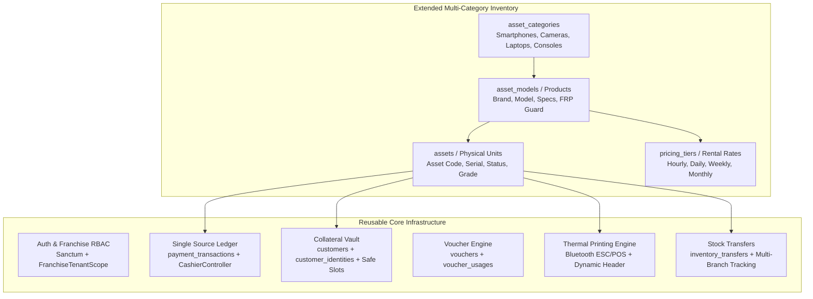
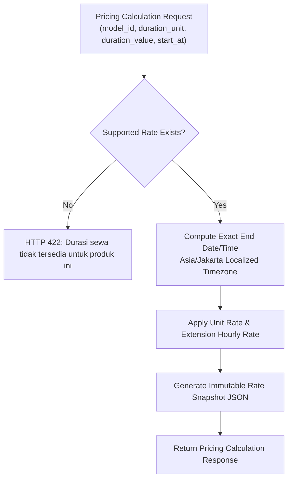

# RentCore — Multi-Category Rental Item Management Implementation Plan

**Document Version:** 1.0.0  
**Date:** October 12, 2026  
**Status:** Architecture Audit & Implementation Blueprint (Pre-Implementation Phase 1)  
**Target Systems:** Laravel 12 Backend API + MySQL 8.0 + Flutter Mobile Client  
**Reference Specification:** `RENTAL_APP_PRD.md` (v1.5.0)  

---

## 1. Executive Summary & Objective

This document provides a comprehensive audit and implementation blueprint for extending the **RentCore (SkyRental)** system from an iPhone-centric operational model to a **Multi-Category Rental Inventory Management System**.

The platform must support physical rental items across diverse consumer electronics and commercial equipment categories, including:
- **Cameras & Photography**: Mirrorless cameras (Sony, Canon, Fujifilm), cinema lenses, gimbals, lighting kits.
- **Computers & Laptops**: Apple MacBooks, gaming laptops (Asus ROG, Lenovo Legion), high-performance rendering workstations.
- **Audio & Presentation**: Projectors, portable PA systems, wireless microphone systems.
- **Gaming & Entertainment**: PlayStation 5, Nintendo Switch, VR headsets (Meta Quest).
- **Smartphones & Tablets (Existing Baseline)**: Apple iPhones, iPads, and flagship Android devices.

The implementation preserves existing franchise multi-tenancy (`affiliates`), role-based access control (RBAC), direct counter rental workflows, POS cashier registers, thermal ESC/POS receipt generation, and payment ledgers while introducing flexible multi-unit pricing (Hourly, Daily, Weekly, Monthly).

---

## 2. Phase 1 — Architecture & Codebase Audit Findings

### 2.1 Inventory & Catalog Architecture

| Component | Existing Implementation | Audit Findings & Evaluation |
| :--- | :--- | :--- |
| **Categories** (`asset_categories`) | `id`, `name`, `slug`, `description`, `is_active`, `timestamps` | **100% Reusable**. Already supports generic category names (`Smartphones`, `Tablets`, etc.). Seeded with electronics categories. |
| **Product Models** (`asset_models`) | `id`, `category_id`, `brand`, `name`, `slug`, `storage_capacity`, `color`, `standard_accessories` (JSON), `is_active` | **Reusable with Non-Destructive Extension**. `storage_capacity` and `color` are currently `NOT NULL VARCHAR(50)`, which causes insertion errors for non-storage items (e.g. projectors, lenses). Lacks `description`, `has_serial_number`, and device-specific flags (e.g. `requires_frp_check`). |
| **Physical Units** (`assets`) | `id`, `affiliate_id`, `model_id`, `asset_code`, `serial_number`, `imei_1`, `imei_2`, `status`, `condition_grade`, `battery_health`, `notes` | **100% Reusable**. Already uses generic `asset_code` and `serial_number`. `imei_1`, `imei_2`, and `battery_health` are already nullable, making them perfectly suited for non-phone hardware. |
| **Pricing Rates** (`pricing_tiers`) | `id`, `model_id`, `duration_hours`, `price`, `extension_hourly_rate`, `is_active` | **Requires Multi-Unit Extension**. Only supports integer hours (`duration_hours` like 6, 12, 24, 48). Must be extended to support configurable duration units (`hour`, `day`, `week`, `month`) and values while maintaining `duration_hours` backwards compatibility. |

### 2.2 Booking, Pricing & Return Dependencies

1. **Absence of Literal `iphone_id`**:
   - The database schema does **not** contain any column named `iphone_id`. The booking relationships already link to `assets.id` through `booking_items.asset_id`.
   - No table renames or destructive relational migrations are needed.
2. **iPhone-Centric Business Rules Identified**:
   - **iCloud / Google FRP Guard in Return Inspections**:
     - In `ReturnService.php` (lines 31–36), the return wizard strictly requires `checklist_results.icloud_removed == true`. Returning a camera, projector, or speaker fails validation unless this check is scoped to categories requiring cloud sign-out.
   - **Duration Assumptions in Booking Creation**:
     - `BookingService.php` (lines 117–134) strictly matches `PricingTier::where('model_id', $asset->model_id)->where('duration_hours', $durationHours)`.
     - Non-iPhone items rented for `1 day`, `3 days`, `1 week`, or `1 month` need duration unit resolution to compute end times and pricing accurately.
   - **Hourly Extension Rate Fallback**:
     - If an item lacks an hourly pricing tier, extension fee calculation in `ReturnService` and `BookingController::extend` falls back to `15,000 IDR/hour`. Multi-category rates must specify explicit extension rates per rate card.
3. **Flutter Mobile UI Hardcoded Constraints**:
   - `direct_rental_screen.dart`:
     - UI strings: `"Pilih unit iPhone terlebih dahulu"`, `"Tidak ada unit iPhone ready sewa"`, `"PILIH UNIT IPHONE TERSEDIA"`.
     - Icon: `Icons.phone_iphone_rounded`.
     - Durations: Defaults to hardcoded fallback `[12, 24, 48]` hours if pricing tiers are absent.
     - Lacks Category Filter Tabs (e.g. "Semua", "Smartphones", "Kamera", "Laptop", "Proyektor", "PlayStation").
   - `return_wizard_screen.dart`:
     - Hardcoded switch `_icloudRemoved` marked as mandatory guard.
   - `inventory_screen.dart`:
     - Lacks Product (Model) creation and Rate configuration UI (only supports registering physical asset units under pre-existing models).

---

## 3. Existing Reusable Components & Systems

To avoid duplicating systems or breaking existing transactions, the following core modules will be preserved and reused directly:



1. **Authentication & RBAC**: `User` model, Sanctum tokens, `super_admin`, `affiliate_admin`, and `staff` permissions.
2. **Franchise Multi-Tenancy**: `FranchiseTenantScope` automatically scopes assets, bookings, and cashier registers to `affiliate_id`.
3. **Financial Ledger & Cashier**: `PaymentTransaction`, `CashierController`, cash change math, POS closing reports.
4. **Collateral Management**: Customer KTP address persistence, safe storage slot allocation (`collateral_storage_slot`).
5. **Voucher Engine**: Minimum spend validation, percentage discounts, and thermal QR slips.
6. **Bluetooth Thermal Struk Printing**: 58mm/80mm ESC/POS driver printing immutable receipt numbers.

---

## 4. Phase 2 — Database and Domain Design

### 4.1 Architectural Decision: Extend Existing Catalog Tables (Zero Table Duplication)

Instead of creating separate, redundant tables (`rental_categories`, `rental_products`, `rental_units`, `rental_rates`), which would fragment bookings, transfers, returns, cashier reports, and audit logs, RentCore will **non-destructively enhance the existing asset tables**.

### 4.2 Proposed Schema Migrations

#### A. Migration: `enhance_asset_models_for_multi_category.php`
```sql
ALTER TABLE asset_models 
    MODIFY storage_capacity VARCHAR(50) NULL,
    MODIFY color VARCHAR(50) NULL,
    ADD COLUMN description TEXT NULL AFTER name,
    ADD COLUMN has_serial_number BOOLEAN NOT NULL DEFAULT TRUE AFTER standard_accessories,
    ADD COLUMN requires_frp_check BOOLEAN NOT NULL DEFAULT FALSE AFTER has_serial_number,
    ADD COLUMN specifications JSON NULL AFTER requires_frp_check;
```
*Rationale*: Allows cameras, lenses, projectors, and audio gear to be created without dummy storage/color values. Flag `requires_frp_check` defaults to `TRUE` for Apple/Android devices and `FALSE` for other equipment.

#### B. Migration: `enhance_pricing_tiers_for_multi_duration_units.php`
```sql
ALTER TABLE pricing_tiers
    ADD COLUMN duration_unit ENUM('hour', 'day', 'week', 'month') NOT NULL DEFAULT 'hour' AFTER model_id,
    ADD COLUMN duration_value INT UNSIGNED NOT NULL DEFAULT 1 AFTER duration_unit;

-- Drop old unique constraint and establish new multi-unit uniqueness
ALTER TABLE pricing_tiers DROP INDEX uq_model_duration;
ALTER TABLE pricing_tiers ADD UNIQUE KEY uq_model_rate_unit (model_id, duration_unit, duration_value);
```
*Backwards Compatibility Guarantee*:
- Existing iPhone tiers (`6h`, `12h`, `24h`, `48h`) receive `duration_unit = 'hour'` and `duration_value = duration_hours`.
- Column `duration_hours` is retained and computed automatically (e.g. 1 Day = 24 Hours, 1 Week = 168 Hours, 1 Month = 720 Hours) so legacy queries continue working without modification.

#### C. Migration: `enhance_booking_items_for_rate_snapshots.php`
```sql
ALTER TABLE booking_items
    ADD COLUMN duration_unit ENUM('hour', 'day', 'week', 'month') NOT NULL DEFAULT 'hour' AFTER unit_price,
    ADD COLUMN duration_value INT UNSIGNED NOT NULL DEFAULT 1 AFTER duration_unit,
    ADD COLUMN rate_snapshot JSON NULL AFTER duration_value;

ALTER TABLE bookings
    ADD COLUMN duration_unit ENUM('hour', 'day', 'week', 'month') NOT NULL DEFAULT 'hour' AFTER duration_hours,
    ADD COLUMN duration_value INT UNSIGNED NOT NULL DEFAULT 1 AFTER duration_unit;
```
*Rationale*: Stores an immutable rate snapshot for each booked item so that future catalog price updates never alter historical transaction reports.

---

## 5. Phase 3 & 4 — Backend Services, Pricing & API Contracts

### 5.1 Centralized Multi-Category Pricing Service (`App\Services\PricingService`)



#### Time & Duration Calculation Rules:
1. **Hour (`hour`)**:
   $$end\_at = start\_at + (duration\_value \times 1\text{ hour})$$
   $$duration\_hours = duration\_value$$
2. **Day (`day`)**:
   $$end\_at = start\_at + (duration\_value \times 24\text{ hours})$$
   $$duration\_hours = duration\_value \times 24$$
3. **Week (`week`)**:
   $$end\_at = start\_at + (duration\_value \times 7\text{ days})$$
   $$duration\_hours = duration\_value \times 168$$
4. **Month (`month`)**:
   $$end\_at = start\_at + (duration\_value \times 1\text{ calendar month})$$
   $$duration\_hours = duration\_value \times 720\text{ (standard billing month)}$$

### 5.2 API Contract Specifications

#### A. Category Management Endpoints
- `GET /api/v1/categories`: List active categories with product counts.
- `POST /api/v1/categories`: Create category (Admin/Super-Admin guarded).
- `PUT /api/v1/categories/{id}`: Update category.

#### B. Product (Model) Management Endpoints
- `GET /api/v1/products`: List products with filtering by `category_id`, search, active status, and paginated response.
- `POST /api/v1/products`: Create product with initial rate cards:
```json
{
  "category_id": 3,
  "brand": "Sony",
  "name": "Sony Alpha A7 IV Body Only",
  "description": "Full-frame mirrorless camera 33MP 4K 60p",
  "standard_accessories": ["2x Baterai NP-FZ100", "Dual Charger", "SD Card 128GB v60", "Strap Kamera"],
  "requires_frp_check": false,
  "rates": [
    { "duration_unit": "day", "duration_value": 1, "price": 300000, "extension_hourly_rate": 25000 },
    { "duration_unit": "day", "duration_value": 3, "price": 800000, "extension_hourly_rate": 25000 },
    { "duration_unit": "week", "duration_value": 1, "price": 1750000, "extension_hourly_rate": 20000 }
  ]
}
```
- `GET /api/v1/products/{id}`: Product detail with rates and physical unit inventory.
- `PUT /api/v1/products/{id}`: Update product information and specs.
- `POST /api/v1/products/{id}/rates`: Add or update rate cards.

#### C. Physical Unit Registration & Management
- `GET /api/v1/assets`: Extended to support filtering by `category_id`, `model_id`, `status`.
- `POST /api/v1/assets`: Register physical unit under product.
- `GET /api/v1/assets/availability`: Check physical unit availability over interval `[start_at, end_at]`.

---

## 6. Phase 5 — Availability & Booking Integration

### 6.1 Server-Side Collision-Proof Availability Engine
A physical unit is available for rental between $T_{start}$ and $T_{end}$ if and only if:
1. `asset.status == 'ready'`.
2. `asset.affiliate_id == user.affiliate_id` (Franchise isolation).
3. No overlapping booking exists with status in `['reserved', 'rented']`:
   $$\neg \exists B \text{ where } B.status \in \{\text{'reserved'}, \text{'rented'}\} \land (B.start\_at < T_{end} \land B.end\_at > T_{start})$$
4. During booking submission, `SELECT ... FOR UPDATE` row locking prevents concurrent double-booking.

### 6.2 Return & Inspection Adaptation (`ReturnService.php`)
- Check `model.requires_frp_check`:
  - If `requires_frp_check == true`: Enforce mandatory iCloud/Google sign-out validation.
  - If `requires_frp_check == false`: Bypass iCloud check, inspect standard physical condition, accessories checklist, and condition grade (A/B/C).

---

## 7. Phase 6 — Flutter UI/UX Design

### 7.1 Multi-Category Booking Screen (`DirectRentalScreen`)
- **Category Filter Dock**: Horizontal category pills at the top (`Semua`, `iPhone`, `Kamera`, `Laptop`, `Proyektor`, `Konsol Game`).
- **Dynamic Unit Card**: Shows product thumbnail, category badge, asset code, serial number, and starting rate.
- **Adaptive Duration Selector**: Populates rate chips based on the selected unit's supported duration units:
  - e.g. `[1 Hari (Rp 300rb)]`, `[3 Hari (Rp 800rb)]`, `[1 Minggu (Rp 1.75jt)]`.
- **Preserved iPhone Flow**: If an iPhone is selected, the traditional 6h/12h/24h/48h duration buttons appear seamlessly.

### 7.2 Inventory & Product Management Screen (`InventoryScreen`)
- **Tab 1: Unit Fisik (Physical Assets)**: Search, status filter (`Siap Sewa`, `Sedang Sewa`, `Perbaikan`), and quick edit modal.
- **Tab 2: Katalog Produk & Tarif (Products & Rates)**: List of products, category chips, rate summary, and "Tambah Produk Baru" modal.
- **Add Product Sheet**: Form capturing Category, Brand, Name, Accessories, FRP requirement, and dynamic rate cards builder.

---

## 8. Test & Regression Prevention Plan (Phase 8)

### 8.1 Backend Feature & Unit Tests
1. `MultiCategoryCatalogTest`: Product creation, rate configuration, category filtering, and slug generation.
2. `MultiUnitPricingServiceTest`: Correct calculation for hours, days, weeks, and months. Rejection of unsupported durations.
3. `MultiCategoryBookingTest`: Booking creation for non-iPhone items, price snapshot integrity, and row locking concurrency.
4. `ReturnInspectionAdaptationTest`: Successful return of non-phone items without iCloud requirement; strict enforcement on iPhones.
5. `RegressionIphoneWorkflowTest`: Verification that existing iPhone counter rental, voucher validation, and POS cashier payment remain 100% unaffected.

### 8.2 Flutter Widget & State Tests
1. Category filter chip switching and asset list filtering.
2. Unit-first selection requirement and adaptive duration rate chip rendering.
3. Successful form payload creation for daily/weekly non-iPhone items.

---

*End of Phase 1 Audit and Architecture Assessment Blueprint.*
